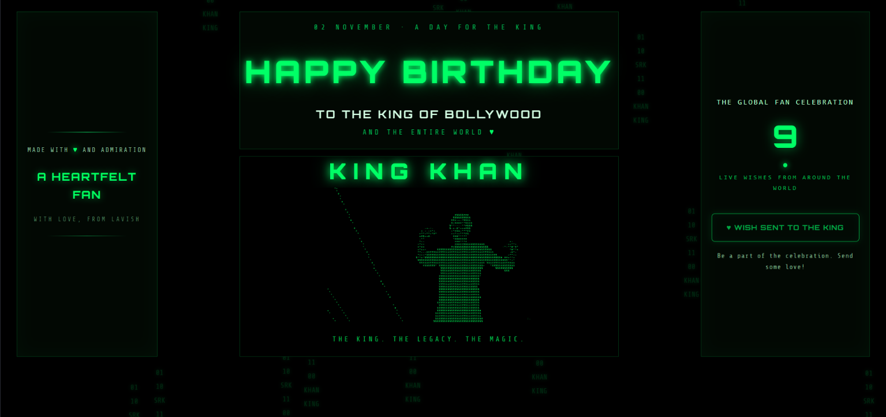
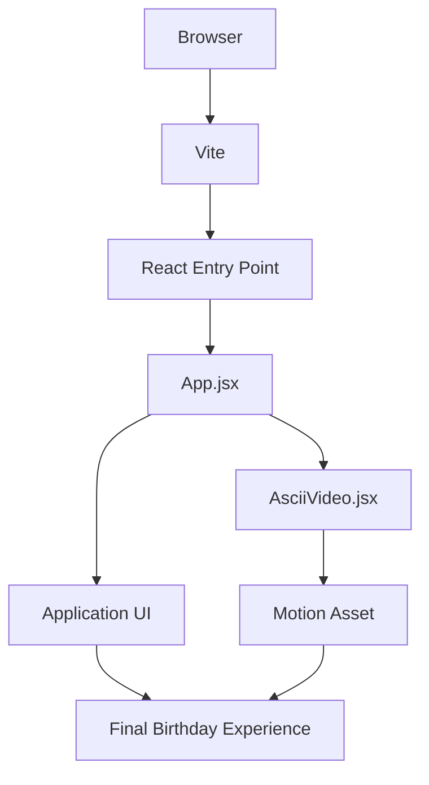

# 👑 SRK Birthday 2026
### A Fan's Birthday Wish to the King, Built with Code.

<p align="center">
  
  
  
</p>

<p align="center">
  <b>Not a product. Not a commercial project. Just a fan's way of wishing the King a happy birthday.</b>
</p>

<p align="center">
  <a href="https://srk-birthday.vercel.app/">
    
  </a>
  <a href="https://github.com/Lavish870/SRK-Birthday-2026">
    
  </a>
</p>

---

## 01. The Tribute — A Birthday Wish to the King

Some people inspire you through their work. Some become a part of your memories, your emotions, and your love for cinema.

For me, Shah Rukh Khan is one of those people.

**SRK Birthday 2026** is a small, personal project created as a birthday tribute to the King of Bollywood.

Instead of making another ordinary birthday poster or greeting, I wanted to experiment with something different — a visual experience built around ASCII art and animation.

It started as a fan-made idea, turned into a coding experiment, and eventually became a little digital tribute that I decided to share with everyone.

<p align="center">
  
</p>

<p align="center">
  <i>A little creation for someone who has given millions of people countless memories.</i>
</p>

**Experience the tribute:**

- 🎬 Live Website: https://srk-birthday.vercel.app/
- 💻 GitHub Repository: https://github.com/Lavish870/SRK-Birthday-2026

---

## 02. The Idea — Why ASCII Art?

The idea was simple: make an SRK birthday wish feel a little different.

I wanted to explore how an ordinary video could be presented through ASCII-style visuals, turning motion into a text-based artistic experience.

ASCII art has a unique charm. It takes something visual and expresses it through characters, symbols, and patterns.

I thought it would be interesting to combine that concept with a birthday tribute.

That became the creative direction of this project.

**The goal was not to build a complex application. It was to experiment, learn, and create something meaningful as a fan.**

---

## 03. The Working — How Does It Work?

One of the interesting parts of this project is the ASCII animation implementation.

The project contains a source motion video and a dedicated React component responsible for the ASCII video experience.

Here is the simplified view of how the main pieces fit together:

```text
        SOURCE VIDEO
       srk-motion.mp4
              |
              v
       ASCII VIDEO COMPONENT
         AsciiVideo.jsx
              |
              v
       REACT APPLICATION
            App.jsx
              |
              v
       BROWSER EXPERIENCE
      ASCII-STYLE VISUALS
```

### Understanding the Important Files

| File | What it does |
|---|---|
| `srk-motion.mp4` | Source motion asset |
| `AsciiVideo.jsx` | Dedicated ASCII video component |
| `App.jsx` | Main application component |
| `App.css` | Application styling |
| `index.css` | Global styles |
| `main.jsx` | React entry point |

The idea is to keep the motion asset and its presentation component separate from the main application structure.

This makes the project easier to understand and maintain.

---

## 04. The Development Journey — Challenges & Learning

This project was also a learning experience.

Implementing animated ASCII artwork was not as straightforward as I initially expected.

Getting the concept into a browser-based React experience required experimentation, particularly around how animated visual content could be presented using ASCII-style artwork.

There were difficulties along the way, and that was one of the reasons I decided to upload the project to GitHub.

I wanted to keep the work accessible, share what I had built, and have something I could revisit and improve.

**What this project gave me:**

- Experience experimenting with ASCII-based visual presentation.
- A better understanding of React component organization.
- Practical experience working with video assets in a web project.
- More familiarity with Vite and frontend development.
- An opportunity to turn a creative idea into a deployed application.

Sometimes the most interesting projects aren't the ones built to solve a business problem. They're the ones that make you curious enough to try something new.

---

## 05. Technology Stack — What Powers It?

The project uses a React and Vite setup with JavaScript and CSS.

### Frontend

<p align="center">
  
</p>

| Technology | Purpose |
|---|---|
| React 19 | Building the user interface with components |
| Vite 8 | Development server and production build |
| JavaScript | Application logic |
| CSS | Styling and visual presentation |

### Services & Development Tools

<p align="center">
  
</p>

| Technology | Purpose |
|---|---|
| Firebase 13 | Firebase integration |
| Node.js | Development runtime |
| npm | Dependency management |
| ESLint | Code quality and linting |
| Vercel | Deployment and hosting |

---

## 06. Project Structure — Inside the Code

Here is a look at how the project is organized.

```text
srk-birthday/
│
├── public/
│   ├── favicon.svg
│   ├── icons.svg
│   └── srk-motion.mp4
│
├── src/
│   ├── assets/
│   │   ├── hero.png
│   │   ├── react.svg
│   │   └── vite.svg
│   │
│   ├── App.css
│   ├── App.jsx
│   ├── AsciiVideo.jsx
│   ├── firebase.js
│   ├── index.css
│   └── main.jsx
│
├── .gitignore
├── eslint.config.js
├── index.html
├── package.json
├── package-lock.json
├── vite.config.js
└── README.md
```

### A Quick Explanation

- **public/** — Stores static assets that can be served directly, including the motion video.
- **src/assets/** — Contains application assets such as the hero artwork.
- **App.jsx** — Main React application component.
- **AsciiVideo.jsx** — Dedicated component for the ASCII animation experience.
- **App.css** — Styles specific to the application.
- **index.css** — Global styles.
- **firebase.js** — Firebase configuration and integration.
- **main.jsx** — Entry point that mounts the React application.
- **vite.config.js** — Vite configuration.
- **package.json** — Project dependencies and development scripts.

The structure keeps the application, visual assets, and configuration files organized in separate places.

---

## 07. Run It Locally — Getting Started

Want to explore the code or run the project on your machine?

You can get started in a few simple steps.

### Prerequisites

- Node.js
- npm
- A modern web browser

### Installation

**1. Clone the repository**

```bash
git clone https://github.com/Lavish870/SRK-Birthday-2026.git
```

**2. Enter the project directory**

```bash
cd SRK-Birthday-2026/srk-birthday
```

**3. Install dependencies**

```bash
npm install
```

**4. Start the development server**

```bash
npm run dev
```

**5. Open the application**

Visit the local URL displayed in your terminal. By default, Vite usually uses:

```text
http://localhost:5173
```

### Additional Commands

Create a production build:

```bash
npm run build
```

Preview the production build:

```bash
npm run preview
```

Run ESLint:

```bash
npm run lint
```

---

## 08. Behind the Scenes — Architecture & Deployment

The application follows a straightforward React component structure.

### High-Level Architecture



### How the Application Comes Together

**1. Application Entry**

Vite serves the application, and `main.jsx` initializes the React application.

**2. Main Interface**

`App.jsx` acts as the main application component and organizes the experience.

**3. ASCII Animation**

`AsciiVideo.jsx` provides a dedicated place for the ASCII video presentation, keeping this functionality separate from the main application.

**4. Visual Assets**

The source motion video and other assets are stored separately from the React components.

**5. Deployment**

The project is deployed on Vercel, making the birthday tribute accessible through a public website.

<p align="center">
  <a href="https://srk-birthday.vercel.app/">
    
  </a>
</p>

---

<p align="center">
  <b>Made by a fan, for the King. 👑</b>
</p>

<p align="center">
  <i>A small birthday wish, a little experiment, and a lot of admiration.</i>
</p>

<p align="center">
  Shah Rukh Khan — The King of Bollywood.
</p>

<p align="center">
  Made with ❤️ by Lavish
</p>